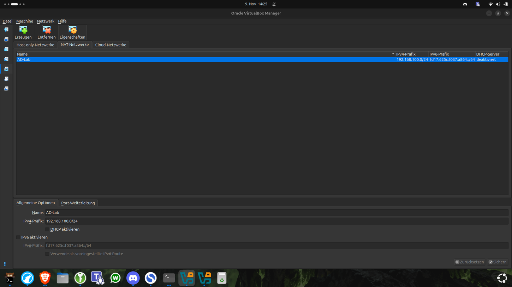
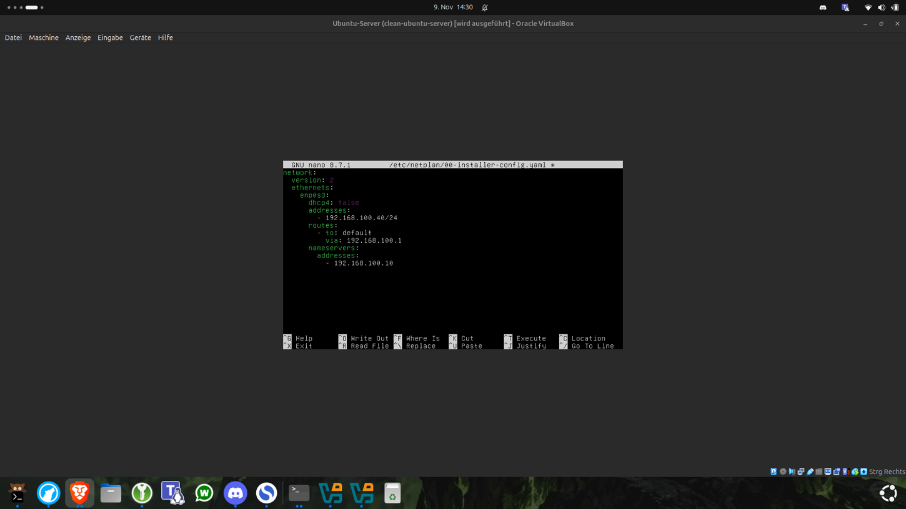
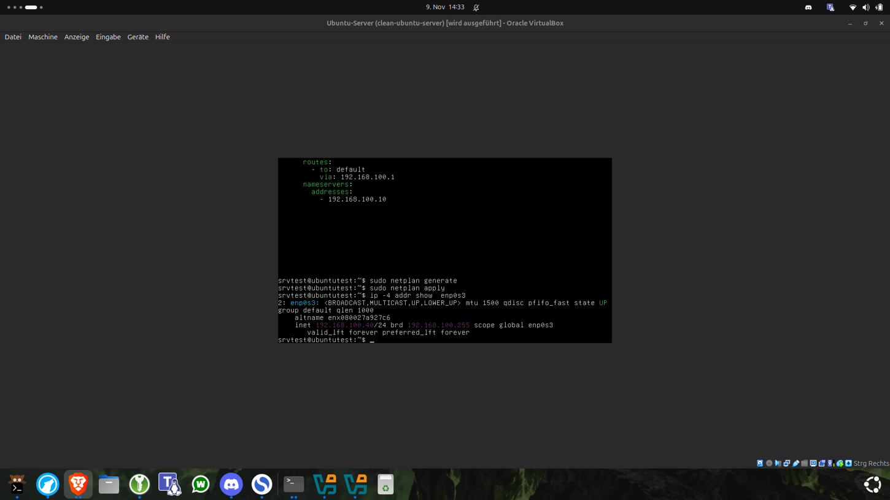
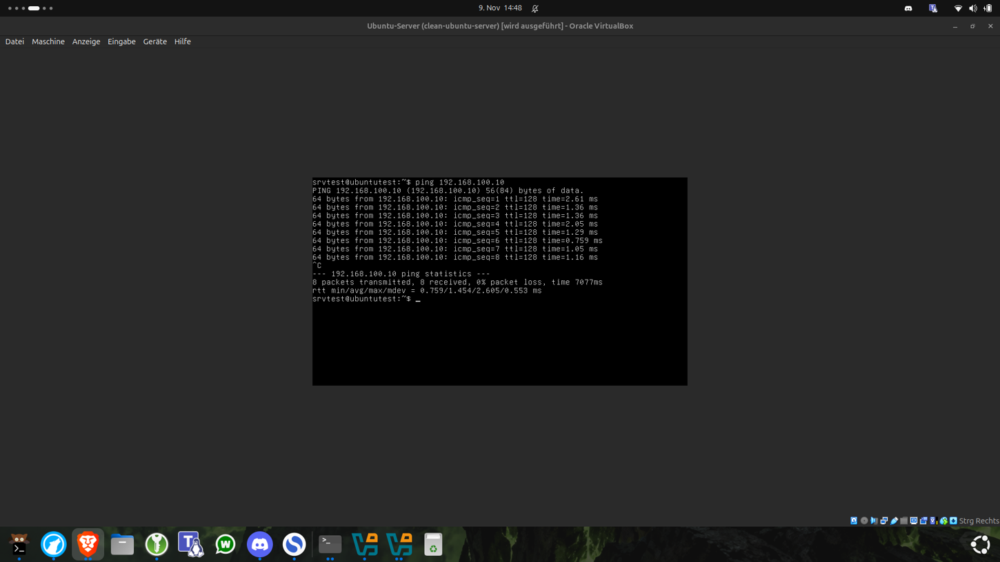
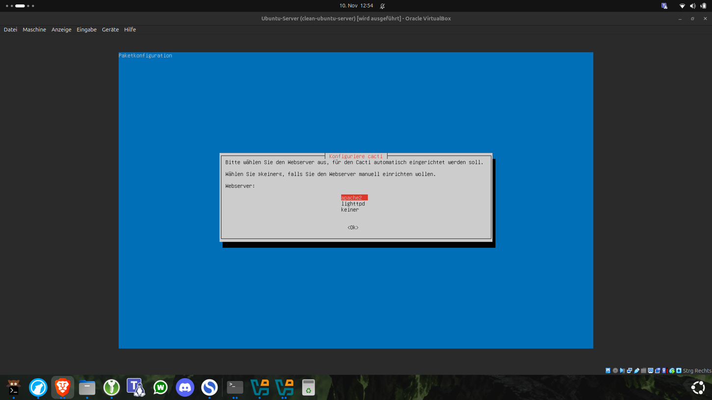
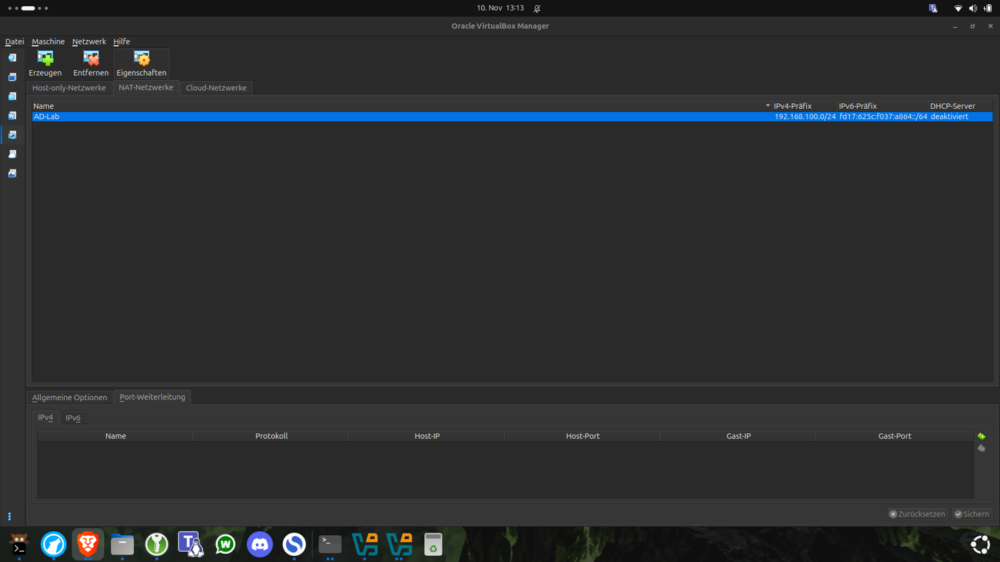
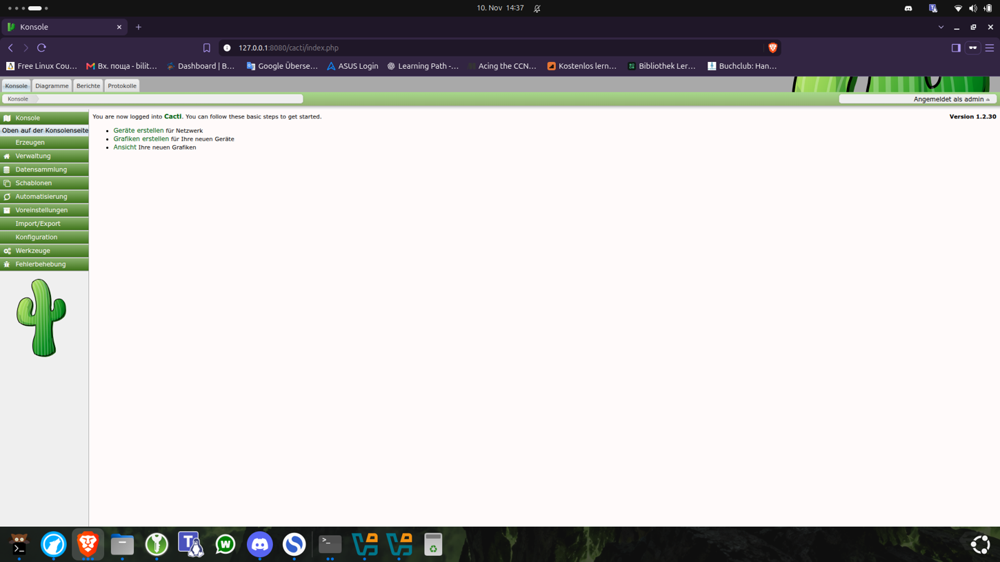

# 10 — Cacti installation in my Active Directory homelab

> **Status:** Installed and login tested ✅  
> **Next:** Part 2 — monitoring devices and graphs *(planned, not completed yet)*

## What is Cacti?

[Cacti](https://www.cacti.net/) is an open-source network monitoring and graphing application. It collects measurements from servers and network devices, often with **SNMP (Simple Network Management Protocol)**, and builds historical graphs using **RRDtool**. A web interface lets an administrator configure devices, view graphs, and inspect trends.

This is useful for understanding CPU usage, memory, bandwidth, and device availability. **Installing Cacti does not automatically configure monitoring for all devices.** That is the goal of Part 2.

## My lab topology

```text
Ubuntu host (Brave browser)
    http://127.0.0.1:8080/cacti/
                 |
     VirtualBox NAT Network forwarding
     127.0.0.1:8080 -> 192.168.100.40:80
                 |
       AD-Lab (192.168.100.0/24)
          |                  |
  AD-SRV01 (Windows)   Ubuntu Server / Cacti
  192.168.100.10       192.168.100.40
  AD DS + DNS          Apache + PHP + MySQL + Cacti
```

- **Virtualization:** Oracle VirtualBox, NAT Network `AD-Lab`
- **Ubuntu Server:** 26.04.1 LTS (`resolute`), existing VM, login account `srvtest`
- **VM resources:** 2 vCPUs, 4 GB RAM, 20 GB virtual disk
- **Cacti:** 1.2.30, installed from Ubuntu `universe`
- **Web server:** Apache2, port 80 inside the VM
- **Database:** MySQL 8.4, database `cacti`
- **Windows domain controller:** `192.168.100.10`

These are **my lab values**, not universal defaults. Before repeating the installation, check that the example IP is unused, and confirm your NAT gateway address.

## 1. Attach the Ubuntu VM to the AD network

In VirtualBox Manager: select the powered-off Ubuntu VM → **Settings / Ändern** → **Network / Netzwerk** → **Adapter 1** → **Attached to: NAT Network / NAT-Netzwerk** → select `AD-Lab`. Keep **Cable connected** enabled.



In my VirtualBox NAT Network settings, the prefix was `192.168.100.0/24` and **DHCP was disabled**. This matters: a guest configured for DHCP will not get an IPv4 lease from VirtualBox when its DHCP service is turned off.

## 2. Find the Linux network interface

```bash
ip link show
ip -4 addr
sudo cat /etc/netplan/*.yaml
```

My adapter was **`enp0s3`**, but the old Netplan configuration referenced **`ens3` and `ens4`** from an earlier setup. `enp0s3` was `UP` and `LOWER_UP` (the interface and virtual link were active) but had no IPv4 address. The old configuration was therefore not appropriate for the current VM adapter.

### Set a static IPv4 address with Netplan

Find the actual filename:

```bash
ls -l /etc/netplan/
```

My file was `/etc/netplan/00-installer-config.yaml`. In the original lab I created a `.bak` backup in `/etc/netplan/`; for a repeatable guide, back it up **outside `/etc/netplan/`** so it cannot be mistaken for a Netplan config:

```bash
sudo cp /etc/netplan/00-installer-config.yaml /root/netplan-before-cacti.yaml
sudo nano /etc/netplan/00-installer-config.yaml
```

Use the following example **only if the address is free, `enp0s3` is your adapter, and your gateway and DNS IPs match**:

```yaml
network:
  version: 2
  ethernets:
    enp0s3:
      dhcp4: false
      addresses:
        - 192.168.100.40/24
      routes:
        - to: default
          via: 192.168.100.1
      nameservers:
        addresses:
          - 192.168.100.10
```

- `dhcp4: false`: manually assigned IPv4 address.
- `/24`: subnet mask `255.255.255.0`.
- `via`: default gateway, commonly `.1` on this NAT network.
- `nameservers`: the AD DNS server; it needs working DNS forwarding/recursion for internet names.



YAML indentation matters (spaces, not tabs). Save with **Ctrl+O**, Enter, **Ctrl+X**. Since we use the VM console, we can safely test network changes without relying on a remote SSH session:

```bash
sudo netplan generate
sudo netplan try
# Accept the configuration after checking it; if needed, it reverts automatically.
ip -4 addr show enp0s3
```

`sudo netplan apply` was the command used in the original lab to activate this configuration. For future changes, `netplan try` is safer if there is any risk of losing remote access.



### Verify routing, DNS, and AD connectivity

```bash
ip route
ping -c 4 192.168.100.10  # Windows domain controller
ping -c 4 1.1.1.1         # Internet reachability without DNS
ping -c 4 google.com      # Internet + DNS name resolution
```



**Observed:** Ubuntu at `.40` reached AD-SRV01 at `.10`, reached `1.1.1.1`, and resolved public names. A successful ping verifies ICMP reachability, not all application protocols.

## 3. Update Ubuntu

```bash
sudo apt update
sudo apt upgrade
lsb_release -a
```

My installation reported `Ubuntu 26.04.1 LTS` (`resolute`). During the upgrade, `grub-pc` asked for the bootloader installation target. In **this BIOS-based VirtualBox VM**, the whole virtual disk `/dev/sda` was chosen, **not** an individual partition (`/dev/sda2`, `/dev/sda3`) or LVM logical volume (`/dev/dm-0`). **Do not blindly select `/dev/sda` on another machine:** verify its boot method and disk layout first.

A kernel update recommended rebooting the VM. Make sure updates have completed before rebooting:

```bash
sudo reboot
```

## 4. Install Cacti

Confirm the package candidate:

```bash
apt-cache policy cacti
```

My Ubuntu `universe` repository offered **`1.2.30+ds1-1ubuntu2`**. Install:

```bash
sudo apt install cacti
```



During the Debian/Ubuntu configuration prompts:

1. Choose **`apache2`** as web server (automatic web configuration).
2. Choose **Yes** for database setup with **`dbconfig-common`**.
3. Follow any additional prompts; do not publish passwords.

Cacti uses Apache/PHP for the web interface, MySQL for application configuration and account records, and RRDtool for historical graph data. SNMP collection will be set up in Part 2.

### Check the installation

```bash
sudo systemctl status apache2
curl -I http://localhost/cacti/
curl -I http://192.168.100.40/cacti/
```

The observed responses included **`HTTP/1.1 200 OK`**. Press **Q** to leave the `systemctl status` pager. The Apache `AH00558` notice about `ServerName` was only a warning, not the cause of the browser issue.

## 5. Open Cacti from the Ubuntu desktop using NAT port forwarding

The host computer is not automatically able to reach a guest in VirtualBox's NAT Network by its guest IP. In **VirtualBox Manager → Network → NAT Networks → AD-Lab → Port Forwarding / Port-Weiterleitung → IPv4**, create:

| Field | Value |
|---|---|
| Rule name | `Cacti-Web` |
| Protocol | `TCP` |
| Host IP | `127.0.0.1` |
| Host port | `8080` |
| Guest IP | `192.168.100.40` |
| Guest port | `80` |



Save the rule. Binding the host address to `127.0.0.1` limits access to the **host computer**, which is suitable for this local learning lab. Cacti is currently served over **HTTP, not HTTPS**; do not publish this port to the internet.

From the **host's terminal**:

```bash
curl -I http://127.0.0.1:8080/cacti/
```

Then open in Brave: **http://127.0.0.1:8080/cacti/**

**Our browser issue:** The first Brave URL contained extra characters after `/cacti/` and returned 404. The exact URL worked in `curl`, and opening the clean URL in a new private window displayed the login screen. When troubleshooting, compare the *exact request URL* and test with `curl` before editing Apache configuration.

## 6. Troubleshooting Cacti admin login

The default `admin/admin` login did **not** work for this installation. The web page reported in German: **“Zugriff verweigert, Benutzerkonto deaktiviert.”** We checked the database, discovered `locked = 1`, unlocked the admin account, and later reset its password. **Do not assume the same cause or credentials on other installations.**

### Identify the installed database server

A first attempt with `mariadb` failed because the command was not installed. The actual packages were **MySQL Server 8.4** and its client:

```bash
dpkg -l | grep -E 'mariadb|mysql'
sudo mysql -e "SHOW DATABASES;"
```

The Cacti database appeared as `cacti`.

### Inspect the admin account (read-only)

```bash
sudo mysql -e "SELECT id, username, enabled, locked, failed_attempts FROM cacti.user_auth WHERE username='admin';"
```

Initially: `admin`, `enabled = on`, `locked = 1`, `failed_attempts = 0`. A lock with zero recorded failed attempts does **not** prove that a failed-login threshold caused the lock.

For **this lab's own admin account**, the lock was cleared by:

```bash
sudo mysql -e "UPDATE cacti.user_auth SET locked=0 WHERE id=1 AND username='admin';"
```

Verify after updating:

```bash
sudo mysql -e "SELECT username, enabled, locked FROM cacti.user_auth WHERE username='admin';"
```

It changed to `locked = 0`, but login was still unsuccessful, so we reset the password as well.

### Reset the password without putting it in shell history

**Caution:** Direct database changes are a recovery method, not the normal way to manage Cacti users. Back up your database first if it contains valuable monitoring data. Prefer an official account-recovery tool if one exists in your installed release; no `reset_password.php` was present in our `/usr/share/cacti/cli/` directory.

On the **Ubuntu Server terminal** (local console), enter a strong, unique password invisibly:

```bash
read -rs -p "New Cacti password: " CACTI_PASS; echo
```

Then generate a PHP hash using standard password hashing:

```bash
CACTI_HASH=$(printf '%s' "$CACTI_PASS" | php -r 'echo password_hash(stream_get_contents(STDIN), PASSWORD_DEFAULT);')
```

Our PHP generated a bcrypt hash beginning with `$2y$`. For this **verified Cacti 1.2.30 lab installation**, the password hash column was confirmed with:

```bash
sudo mysql -e "SHOW COLUMNS FROM cacti.user_auth LIKE 'password';"
```

It was `varchar(256)`. Save the new hash without embedding the plaintext password in shell history:

```bash
printf "UPDATE user_auth SET password='%s' WHERE username='admin' AND id=1;\n" "$CACTI_HASH" | sudo mysql cacti
```

Verify only the prefix, not the full hash:

```bash
sudo mysql -e "SELECT username, enabled, locked, LEFT(password, 4) AS hash_prefix FROM cacti.user_auth WHERE username='admin';"
```

Clear the temporary shell variables immediately:

```bash
unset CACTI_PASS CACTI_HASH
```



**Observed final result:** Logging in through Brave with `admin` and the new private password succeeded. We reached the Cacti **Console / Konsole** screen, version **1.2.30**.

> **Security note:** A hash is not plaintext, but it is still sensitive account material. Never commit database dumps, full hashes, passwords, session cookies, or files containing live credentials to GitHub. A local lab on HTTP should remain host-only; use TLS and stricter access controls before making this available beyond the host.

## 7. What I learned (FISI notes)

| Term | Explanation |
|---|---|
| NAT Network | Allows VMs on the same VirtualBox NAT network to communicate and typically reach the internet through NAT |
| DHCP | Automatically leases IP configuration; it was **disabled** in our AD-Lab NAT Network |
| Static IPv4 | A manually assigned address that stays predictable for server use |
| Netplan | Ubuntu's YAML-based network configuration layer |
| Default gateway | Router next hop used for destinations outside the local subnet |
| DNS | Translates names (like `google.com`) into IP addresses |
| Apache2 | HTTP web server that serves Cacti's PHP web interface |
| MySQL | Stores Cacti's app configuration and users |
| Port forwarding | Maps the host's `127.0.0.1:8080` to the guest's `192.168.100.40:80` |
| PHP password hash | One-way hash used to validate passwords without storing plaintext |
| HTTP 200 | Server returned a successful HTTP response; it does **not** prove login succeeded |
| HTTP 404 | The requested resource/path was not found |

## 8. Outcome and next steps

**Completed:** Ubuntu networking fixed; Cacti package installed; Apache and MySQL working; local browser access available; administrator login successful.

**Not yet completed:** SNMP setup, polling verification, adding monitored devices, and building CPU/network graphs. Those belong to **Part 2 — Monitoring with Cacti**.

### References

- [Cacti official site](https://www.cacti.net/)
- [Cacti documentation](https://docs.cacti.net/)
- [Ubuntu Netplan documentation](https://netplan.readthedocs.io/)
- [VirtualBox documentation](https://www.virtualbox.org/manual/)
